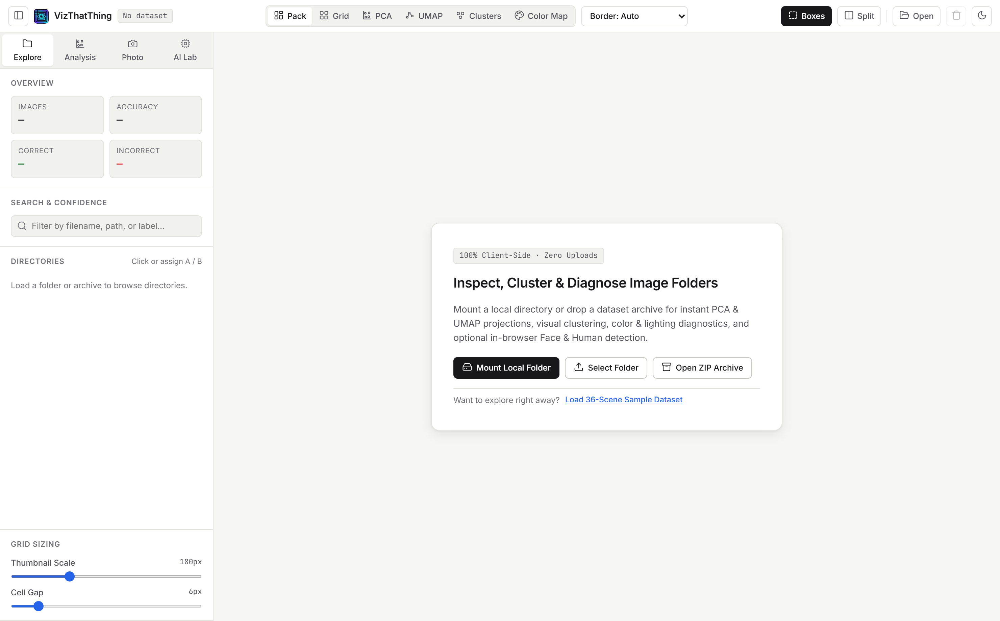

# VizThatThing

> **Client-Side Visual Analytics, Photography Diagnostics & Dataset Inspector for Image Folders and Computer Vision Archives.**

**VizThatThing** is a fast, zero-upload browser workbench for exploring, clustering, and diagnosing image folders and ML datasets locally on your machine. It combines a high-density HTML5 spatial canvas, an off-main-thread Web Worker analytics engine (**PCA**, **UMAP**, **K-Means++**, **Color Maps**, **Photography Exposure & Focus Metrics**), and **strictly on-demand browser AI** (**Face Detection**, **Human Detection**, and **CLIP Semantic Themes**) in a clean Light-Mode interface.

---

## Core Capabilities

### 1. Six Spatial Canvas Modes + Dual Render Toggle
Switch seamlessly with animated transitions across six 2D spatial layouts:
- **Pack**: Custom 2D growing bin packer maximizing screen density across mixed aspect ratios.
- **Grid**: Aspect-preserving justified row layout for comfortable sequential scanning.
- **PCA**: Matrix-free 2D Principal Component Analysis with explained variance readouts (`PC1` / `PC2`).
- **UMAP**: Deterministic PCA-initialized 2D UMAP manifold projection (`nNeighbors` configurable).
- **Clusters**: Groups images into titled K-Means++ **Cluster Islands** with automatic silhouette $k$-selection (`Auto` or explicit $k = 2\dots12$).
- **Color Map**: Projects images onto a 2D **Hue × Luminance** spectrum or **Color Temperature × Exposure** plane.

In 2D analytical views (`PCA`, `UMAP`, `Clusters`, `Color Map`), toggle between:
- **Images (`Sprites`)**: Scaled image thumbnails directly on the coordinate plane (with optional overlap relaxation).
- **Points (`Point Cloud + Landmarks`)**: Plots the entire filtered dataset at 60fps as color-encoded vector points with **pinned medoid landmark thumbnails** over each cluster centroid and instant image previews on hover.

### 2. Photography & Technical Quality Diagnostics *(Zero Model Downloads)*
Computed automatically inside a dedicated `OffscreenCanvas` Web Worker (`~13 KB`):
- **Lighting & Exposure**: Detects `Underexposed`, `Balanced`, `Overexposed`, and `Low Contrast` images, measuring shadow clipping (`% pixels < 12`), highlight clipping (`% pixels > 243`), luminance, contrast, and warm/cool color temperature.
- **Focus & Sharpness**: Computes a normalized `3×3` **Laplacian Variance** score (`0–100`) to isolate `Blurry`, `Soft`, and `Sharp` shots.
- **Color & Theme Telemetry**: Extracts 5-swatch dominant hex palettes (click to copy `#hex`), dataset-wide color family distributions, and multi-label visual themes (`Warm`, `Cool`, `High-Key`, `Low-Key`, `Vibrant`, `Muted`, `Monochrome`, `High-Contrast`, `Detailed`).
- **Resolution & Aspect Geometry**: Buckets images by megapixel tier (`Tiny <0.5MP`, `SD`, `HD`, `FHD`, `4K+`) and aspect ratio (`Portrait`, `Square`, `Standard`, `Wide`).

### 3. On-Demand Browser AI Lab *(0 Bytes Downloaded Until Clicked)*
No ML runtimes or weights are bundled in the application build. Models stream from CDN into persistent browser `Cache` storage (with live byte progress bars and a one-click **Purge Cache** button) only when triggered:
- **Face Detection (`~230 KB`)**: MediaPipe BlazeFace short-range detector with bounding-box overlays and `Has Faces (1+)`, `Group (2+)`, and `No Faces` filters.
- **Human Detection (`~4.6 MB`)**: EfficientDet-Lite0 (`int8`) person detector with bounding-box overlays and person/crowd count filters.
- **CLIP Semantic Embeddings & Custom Themes (`~85 MB`)**: Quantized `CLIP ViT-B/32` via Transformers.js—upgrades PCA, UMAP, and K-Means++ from 64-dim visual appearance vectors to **512-dim semantic embeddings**, and supports custom comma-separated zero-shot theme prompts (e.g., `portrait, street, nature, indoor, vehicle, document, night`).

### 4. Linked Split View & Dataset Annotations
- **Zero-Upload Ingestion**: Mount local directories via the **File System Access API**, select folders, drag-and-drop `.zip` archives (`JSZip`), or launch the built-in 36-scene synthetic sample dataset in one click.
- **Synchronized Dual Viewports**: Compare `train` vs `val` or `Correct Only` vs `Errors Only` side-by-side with optional pan/zoom synchronization.
- **Native Metadata & YOLOv8 Support**: Automatically ingests `.csv`, `.tsv`, and `.json` classification predictions/confidences as well as **YOLOv8** `data.yaml` class names and `labels/*.txt` ground-truth bounding boxes.

---

## Workbench Preview

1. **K-Means++ Cluster Islands & Visual Analytics**
   

2. **UMAP Point Cloud with Pinned Cluster Medoid Landmarks**
   

3. **2D Hue × Luminance Color Map & On-Demand AI Lab**
   

4. **Photography Inspector Modal (RGB/Luminance Exposure Curve, Hex Palette & Quality Metrics)**
   

5. **Split-Screen Error Diagnostics (Correct vs. Incorrect Predictions)**
   

6. **Light-Mode Landing Interface**
   

---

## Quick Start

```bash
# Install dependencies
npm install

# Start local Vite development server
npm run dev

# Run unit tests (pixel/photo metrics, PCA, UMAP, K-Means++, spatial layouts, YOLO/CSV parsers)
npm test

# Build production bundle
npm run build
```

To generate a standalone `.zip` test archive from the CLI (or simply click **Load 36-Scene Sample Dataset** on the app's start screen):

```bash
node generate_demo.js
```

---

## Supported Metadata & Annotation Formats

### 1. Classification CSV / TSV / JSON
Include a `.csv`, `.tsv`, or `.json` file anywhere in your folder or `.zip` archive:

```csv
filename,label,prediction,confidence,loss
images/train/sample_01.png,cat,cat,0.9421,0.0410
images/train/sample_02.png,dog,cat,0.7251,1.4250
```

Recognized keys (case-insensitive):
- **File match**: `filename`, `full_path`, `path`, `image`, `img`, `id`, `name`
- **Ground truth**: `label`, `ground_truth`, `gt`
- **Model output**: `prediction`, `pred`, `confidence`, `score`, `loss`

### 2. YOLOv8 Object Detection / Segmentation Archives
Drop or mount any standard YOLO directory containing `data.yaml` (or `classes.txt`) alongside `images/` and `labels/*.txt`. Ground-truth bounding boxes and class names are automatically parsed and rendered on the canvas and in the fullscreen inspector.

---

## Tech Stack

- **Core**: Vanilla ES6 Modules, HTML5 2D Canvas, `OffscreenCanvas`, Web Workers
- **Analytics**: Custom zero-dependency 64-d visual/photo extractor, Matrix-free PCA, PCA-initialized UMAP, Seeded K-Means++ with Silhouette Auto-$k$
- **Lazy Browser ML**: `@mediapipe/tasks-vision` (BlazeFace, EfficientDet-Lite0) & `@huggingface/transformers` (CLIP ViT-B/32) loaded dynamically on demand with `Cache` API persistence
- **Build & Test**: Vite, `jszip`, Node native test runner (`node --test`)

---

## License

MIT License
