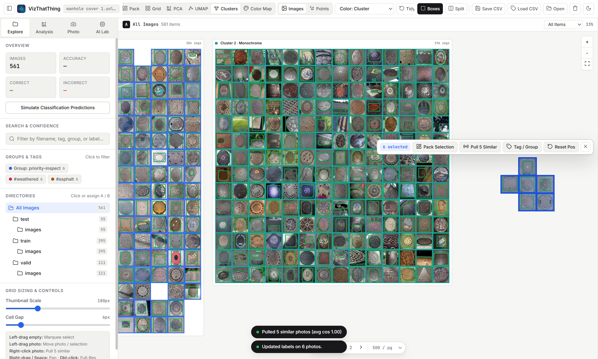
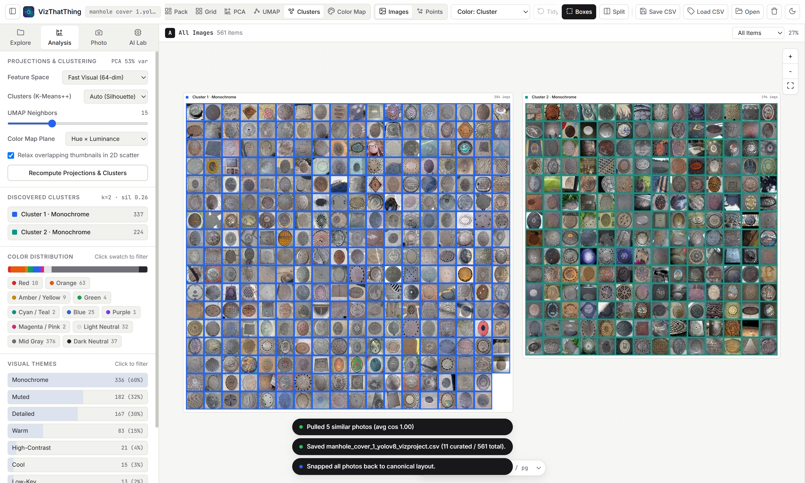
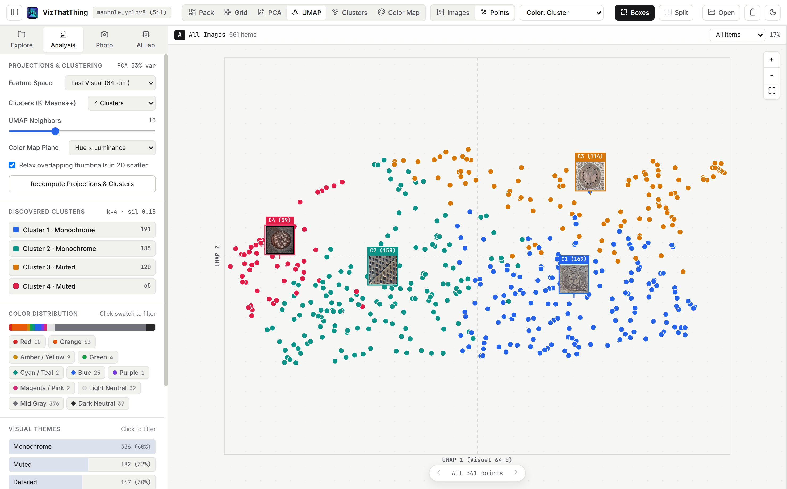
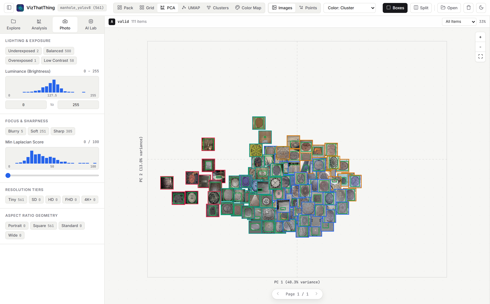
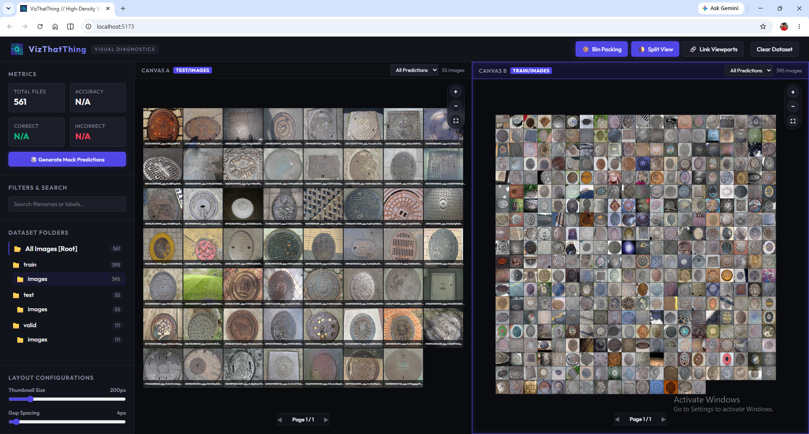
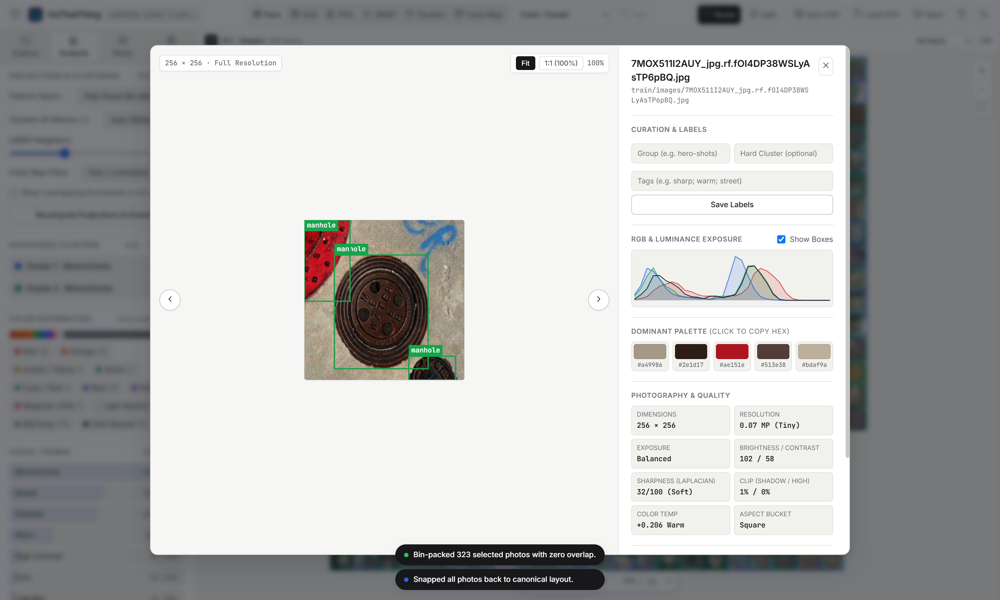
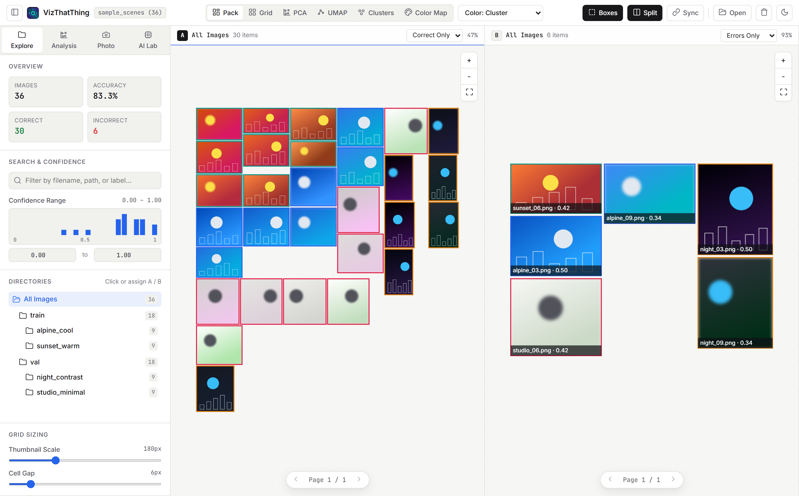

# VizThatThing

> **Local-First Spatial Curation, Visual Analytics & Photography Diagnostics for Image Folders and Computer Vision Datasets.**

**VizThatThing** turns raw image folders and `.zip` archives into a fast, interactive 2D workbench right in your browser—with **zero server uploads** and **zero bundled ML bloat**. Render hundreds of high-resolution photos smoothly via **256px downscaled sprites**, project datasets with **PCA**, **UMAP**, **K-Means++**, and **Color Maps**, freely drag or **right-click any photo to pull its 5 nearest cosine-similar neighbors**, marquee-select overlapping stacks to **bin-pack them in place**, inspect **1:1 full-resolution originals** on double-click, and save all **tags, groups, cluster overrides, and custom positions** into a single portable `.csv`.

**Tech Stack:** `Vanilla ES6 Modules` · `HTML5 2D Canvas` · `OffscreenCanvas Web Workers` · `Custom PCA / UMAP / K-Means++` · `JSZip` · `On-Demand MediaPipe & Transformers.js (CLIP)` · `Vite`



---

## Visual Tour

| K-Means++ Cluster Islands & Analytics | UMAP Point Cloud + Medoid Landmarks |
| :---: | :---: |
|  |  |
| **Photography Quality & 2D PCA** | **2D Color Map & On-Demand AI Lab** |
|  |  |
| **Double-Click Full-Resolution Lightbox & Tagging** | **Linked Split-Screen Error Comparison** |
|  |  |

---

## Core Capabilities

### 1. Spatial Curation, Cosine Retrieval & Marquee Bin-Packing
- **Free-Drag & Tidy Reset**: Drag individual photos or multi-selections anywhere on the canvas to curate custom visual boards; click **Tidy** at any time to smoothly snap every photo back to its canonical layout.
- **Right-Click Cosine Similarity Pull**: Right-click any photo to pull its **5 most cosine-similar images** across the entire dataset (using `512-d CLIP` if computed, or the built-in `64-d` visual embedding) into a non-overlapping ring around it. Right-clicking again automatically skips neighbors already within the local radius and pulls the **next 5** into an outer ring.
- **Marquee Selection + Local Bin-Packing**: Left-drag across heavily stacked or overlapping scatter regions to highlight them, then click **Pack Selection** (or press `P`) to bin-pack just those selected images in place with zero overlap.
- **Tagging, Grouping & Single-CSV Persistence**: Assign **Group Names**, **Theme Tags**, and **Hard Cluster Overrides** from the floating selection bar or fullscreen inspector. Click **Save CSV** to export a single `<dataset>_vizproject.csv` containing both labels and custom `(x, y)` coordinates—automatically restored whenever that folder or `.zip` is reopened.

### 2. High-Density Performance & Full-Resolution Lightbox
- **256px Downscaled Canvas Sprites + Page Cap**: High-megapixel photos are downscaled to lightweight `<= 256px` canvas sprites on decode (with a configurable `250 / 500 / 1000 / All` page cap, defaulting to `500 / pg`) so 4K/24MP folders pan and zoom at 60fps without exhausting GPU/RAM.
- **Double-Click Full-Resolution Lightbox**: Double-click any thumbnail to inspect the un-downscaled original file on demand with mouse-wheel pixel zoom, `Fit` vs `1:1 (100%)` presets, drag-pan, RGB exposure curves, and automatic `Blob` URL cleanup on close.

### 3. Six Spatial Modes + Dual Render Toggle
Switch with animated transitions across six 2D layouts:
- **Pack**: Custom 2D growing bin packer maximizing screen density across mixed aspect ratios.
- **Grid**: Aspect-preserving justified row layout for sequential scanning.
- **PCA**: Matrix-free 2D Principal Component Analysis with explained variance readouts (`PC1` / `PC2`).
- **UMAP**: Deterministic PCA-initialized 2D UMAP manifold projection (`nNeighbors` configurable).
- **Clusters**: Groups images into titled K-Means++ **Cluster Islands** (plus pinned manual-cluster islands) with automatic silhouette $k$-selection (`Auto` or explicit $k = 2\dots12$).
- **Color Map**: Projects images onto a 2D **Hue × Luminance** spectrum or **Color Temperature × Exposure** plane.

In 2D analytical views (`PCA`, `UMAP`, `Clusters`, `Color Map`), toggle between **Images** (thumbnails) and **Points** (unpaginated 60fps vector point cloud with pinned cluster medoid landmarks and 256px hover previews).

### 4. Photography Diagnostics & On-Demand Browser AI
- **Zero-Download Photography Metrics** *(computed in a `~13 KB` Web Worker)*: Exposure classification (`Underexposed`, `Balanced`, `Overexposed`, `Low Contrast`), shadow/highlight clipping, `3×3` Laplacian sharpness (`Blurry`, `Soft`, `Sharp`), 5-swatch hex palettes, visual themes, megapixel tiers, and aspect buckets.
- **Strictly On-Demand Browser AI Lab** *(0 bytes downloaded until clicked)*:
  - **Face Detection (`~230 KB`)**: MediaPipe BlazeFace detector + face count filters.
  - **Human Detection (`~4.6 MB`)**: EfficientDet-Lite0 (`int8`) person detector + crowd filters.
  - **CLIP Semantic Embeddings & Themes (`~85 MB`)**: Quantized `CLIP ViT-B/32` upgrading projections and right-click cosine retrieval to **512-d semantic vectors** plus custom zero-shot theme prompts.

---

## Desktop Pointer & Keyboard Controls

| Action | Gesture / Shortcut |
| :--- | :--- |
| **Marquee Select** | `Left-drag` on empty canvas (`Shift` to add/toggle) |
| **Move Photo / Selection** | `Left-drag` on a photo or selected group |
| **Pull 5 Cosine-Similar Photos** | `Right-click` on a photo (repeat to pull next ring of 5) |
| **Pan Viewport** | `Right-drag`, `Middle-drag`, or `Space + Left-drag` |
| **Zoom Viewport** | `Mouse wheel` (cursor-centered) |
| **Bin-Pack Selected Stack** | Click **Pack Selection** or press `P` |
| **Open Full-Resolution Lightbox** | `Double-click` on a photo (`←` / `→` to step, `Esc` to close) |

---

## Quick Start

```bash
# Clone the repository
git clone https://github.com/somerandomguy-coder/VizThatThing.git
cd VizThatThing

# Install dependencies
npm install

# Start local Vite development server
npm run dev

# Run unit tests (24 tests covering similarity, bin-packing, CSV persistence, PCA/UMAP/K-Means++, YOLO)
npm test

# Build production bundle
npm run build
```

---

## Supported Metadata, Project CSV & YOLOv8 Formats

### 1. Project Curation & Classification CSV / TSV / JSON
Click **Save CSV** in the top toolbar to export `<dataset>_vizproject.csv`, or drop any `.csv`, `.tsv`, or `.json` file alongside your folder / `.zip` archive:

```csv
filename,full_path,label,prediction,confidence,tags,group,cluster_override,custom_x,custom_y
sample_01.jpg,train/sample_01.jpg,cat,cat,0.9421,sharp;outdoor,hero-set,Cluster A,420,180
sample_02.jpg,valid/sample_02.jpg,dog,cat,0.7251,night;motion-blur,review,,
```

When loading a folder (`Select Folder`) or `.zip` archive (`Open ZIP Archive`), VizThatThing automatically detects any `.csv` inside and maps rows by `full_path` first (falling back to `filename`) to restore your tags, groups, hard cluster overrides, predictions, and custom spatial coordinates.

### 2. YOLOv8 Object Detection / Segmentation Archives
Select or drop any standard YOLO dataset containing `data.yaml` (or `classes.txt`) alongside `images/` and `labels/*.txt`. Ground-truth bounding boxes and class names are rendered on the spatial canvas and inside the full-resolution lightbox.

---

## License

MIT License
